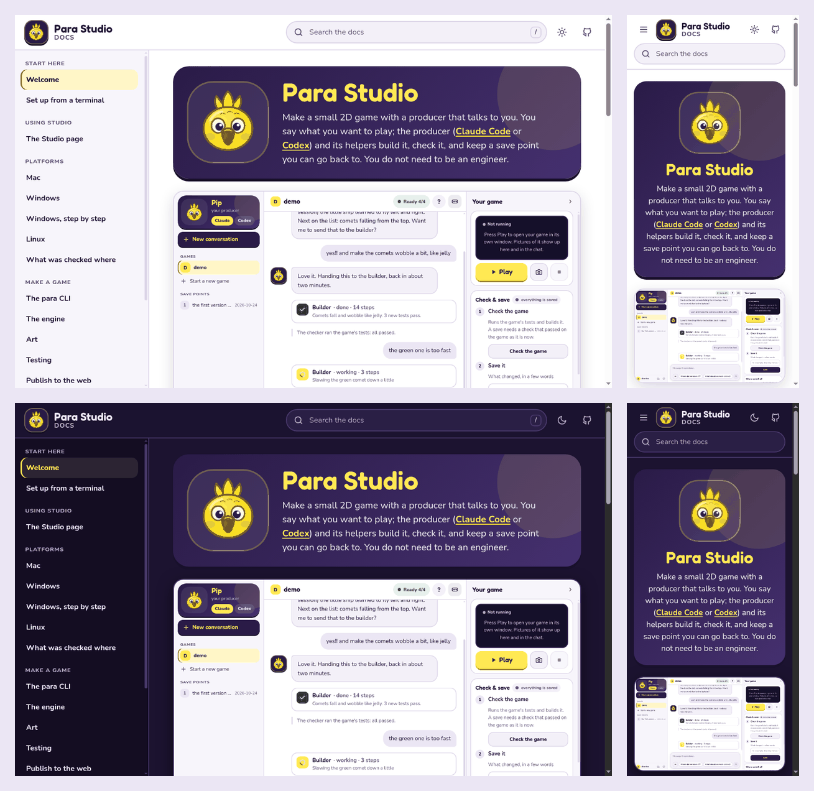
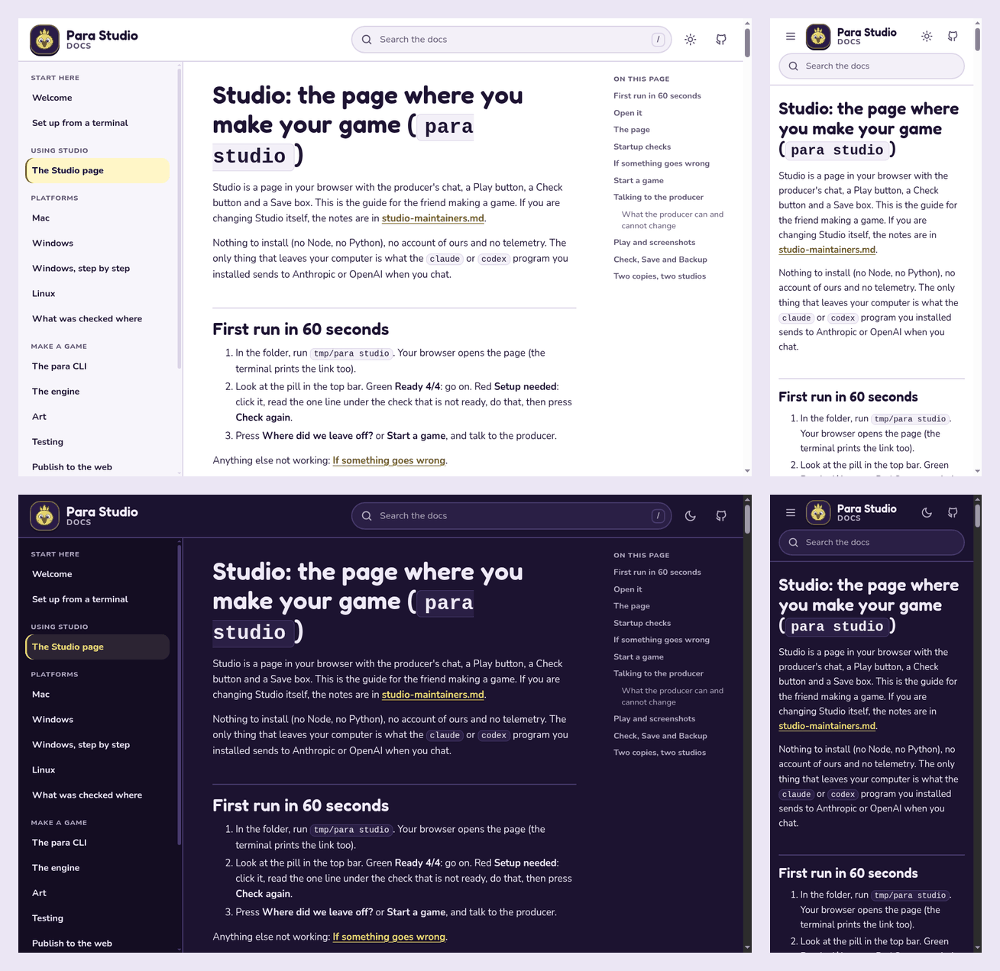

# This site: how the docs are built

The documentation site is generated from the markdown files in `docs/`. They stay where they
are, so every link to `docs/*.md` (from the README, the launchers and `para`) keeps working and
nothing is written twice. Published at <https://pdepaula.github.io/parastudio/>.

## Build and preview

You need [uv](https://docs.astral.sh/uv/) (the art tools use it too). From the repository root:

```sh
uv run tools/docs/build.py            # build into tmp/site/ and check it; exit 1 on any finding
uv run tools/docs/build.py --serve    # the same, then serve it at http://127.0.0.1:8000/
```

uv reads the one dependency, `markdown-it-py`, pinned exactly in the script's header, and
installs it from `tools/docs/build.py.lock` (hashes included). Every URL in the output is
relative, so the same files work at the site's base path (`/parastudio/`) and on a local server.

## Adding or moving a page

Write the page as `docs/<name>.md` with one `#` heading, then add it to `NAV` at the top of
`tools/docs/build.py` (the left navigation, in reading order). The build fails while a page is
missing from `NAV`. Link to other pages by their file, as on GitHub (`[Testing](testing.md)`); the
build turns that into the page's address. A link to a file outside `docs/` (`../AGENTS.md`)
becomes a link to that file on GitHub. The home page is `docs/index.md`: its first paragraph sits
beside Pip at the top, and each `##` section is a card.

## What the build checks

The `docs` job in `.github/workflows/ci.yml` runs the build on every pull request and every push to
`main`, and fails on any of these:

- a page in `docs/` that is not in `NAV`, or a `NAV` entry with no page
- a relative link or image whose file does not exist, or a `#anchor` with no matching heading
  (README.md's links are checked too)
- an absolute link (`/like/this`), which would break under the site's base path
- an image with no alt text
- headings out of order: one `#` per page, and no level skipped on the way down
- anything that looks like a home folder path with a real name in it, a tailnet address or an
  email address, in the sources or the built pages (the job prints only the first characters of
  what it found)

`.github/workflows/pages.yml` builds the same site on every push to `main` and deploys it to
GitHub Pages with `actions/upload-pages-artifact` and `actions/deploy-pages`.

## The installers

The build also copies the one-line installers, `tools/launcher/install.sh` and
`tools/launcher/install.ps1`, to the site's root (`install.sh`, `install.ps1`;
[Install with one line](install.md)). It writes the commit it is built from (`git rev-parse HEAD`,
the commit Pages deploys) into the one empty `PARASTUDIO_COMMIT` line of each and changes nothing
else, so the published script clones exactly the code it was published with. There is no second
copy to keep in step: after the build, the `docs` job runs `.github/scripts/installer-copy-check.sh`,
which fails if a published installer is anything other than its source with that one line filled
in. The `installer` workflow (`.github/workflows/installer.yml`) runs the published copies end to
end on Linux, macOS and Windows runners.

## The look

The site uses the Studio page's look ([Studio internals](studio-maintainers.md)): the same colour
tokens (royal purple and Nim gold), Nunito and Fredoka (copied from `tools/para/studio/fonts/`
into the site, so the page loads nothing from anywhere else) and Pip. The theme is
`tools/docs/theme/`: `page.html`, `hero.html`, `pip.svg`, `site.css` and `site.js`, which
holds the light / dark / follow-the-computer switch, the phone menu and search over an index the
build writes (`search-index.js`).





Every text colour pair passes WCAG AA in both looks: the lowest is the light look's link gold on
the code background (5.5:1), and the focus ring is at least 3.5:1 against every background. The
site can be used with the keyboard alone: a skip link, visible focus rings, `/` to search, the arrow
keys and Enter in the results, and Escape to close the menu or the results.

## Why this and not a docs framework

The site needed search, a left navigation, light and dark looks and a phone layout, in the
Studio's look, built by one command, with as few new moving parts as possible in a Nim repository
that already uses uv and Python for its art tools.

**Chosen: a small Python builder** (`tools/docs/build.py`, about 500 lines, one pinned
dependency). It renders the markdown with markdown-it-py, wraps it in the Studio Desk theme and
writes a search index. All the checks above live in the same script, and the look is the Studio's
own CSS, not a framework theme bent to match.

Runner-ups:

- **MkDocs with Material.** The most complete off-the-shelf option (search, navigation, light and
  dark). Not chosen: about twenty pinned Python packages for one site; Material fetches Google
  Fonts unless told not to; matching the Studio look means overriding its templates and fighting
  its styles; links to files outside `docs/` need a plugin or hook; and Material itself is now in
  maintenance mode.
- **mdBook.** One binary, built-in search and themes. Not chosen: a Rust binary to download and
  pin per platform, a `SUMMARY.md` that would have to live in `docs/`, a theme that is changed by
  overriding handlebars templates, and link checking needs a second plugin binary.
