# Studio: the page where you make your game (`para studio`)

Studio is a page in your browser with the producer's chat, a Play button, a Check button and a
Save box. This is the guide for the friend making a game. If you are changing Studio itself, the
notes are in [studio-maintainers.md](studio-maintainers.md).

Nothing to install (no Node, no Python), no account of ours and no telemetry. The only thing
that leaves your computer is what the `claude` or `codex` program you installed sends to
Anthropic or OpenAI when you chat.

## First run in 60 seconds

1. In the folder, run `tmp/para studio`. Your browser opens the page (the terminal prints the link
   too).
2. Look at the pill in the top bar. Green **Ready 4/4**: go on. Red **Setup needed**: click it,
   read the one line under the check that is not ready, do that, then press **Check again**.
3. Press **Where did we leave off?** or **Start a game**, and talk to the producer.

Anything else not working: [If something goes wrong](#if-something-goes-wrong).

## Open it

In the folder, run:

```
tmp/para studio
```

It opens the page in your browser and prints a link too. The link carries a random key that
changes every run, so use the new link each time. Ctrl+C in that terminal stops Studio; it also
closes the game window Studio opened and ends a chat turn that is still running. Closing the
browser tab does not stop it.

- `--port N` picks the port, `--no-open` only prints the link, `--game NAME` starts on one game.
- Going back to an earlier save point and setting work aside are not in the page yet (use
  `para save --back` / `--set-aside` in the terminal).

## The page

The page is a desk in three columns, big and round on purpose:

- **On the left**, Pip's card: the producer's face (it bobs while idle, thinks while a turn
  runs and talks when an answer arrives) and, when this computer knows more than one, the
  **Claude** / **Codex** pick for the game. Under it **New chat**, your **Chats** with this
  game's producer (see "Your chats" below), the games in this folder (click one to switch),
  **Start a new game**, the save points, and at the bottom
  your name, **Back up online** (the cloud; it asks first and says what goes online and where)
  and the light / dark / follow-the-computer switch. The name on the card is Pip unless the
  game's `PLAN.md` says `Call the producer:` something other than "producer". On a phone this
  column is a drawer behind the menu button.
- **In the middle**, the conversation and the message box. Under the box's text are the
  **+** menu (Show me a screenshot, Check the game, Save…) and two quick replies, "Where did
  we leave off?" and "What should we work on next?". The top bar has the game's name (a menu
  when there are several), a **Running** pill while the game window is open, the **startup
  checks** pill, **?** for help, and the button that shows or hides the game panel.
- **On the right**, the game panel: **Play** (or **Play again**), **Show me a screenshot**
  and **Stop game**, the newest picture of the game window, **Check & save** (Check the game,
  then a note and Save; the badge says what is next: unsaved changes, ready to save, or
  everything saved), and **Where we left off**. On a window narrower than 1100px the panel
  slides in over the chat from that button instead.

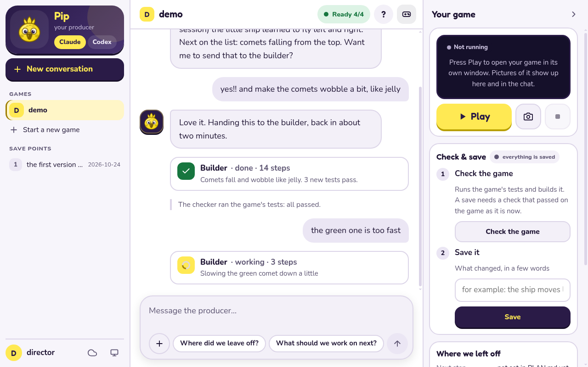

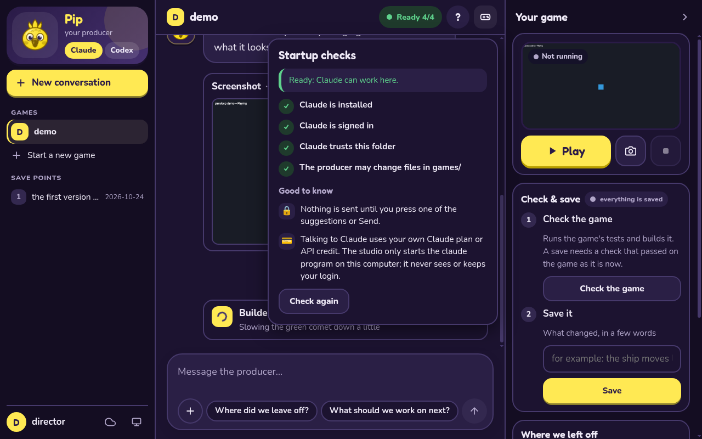

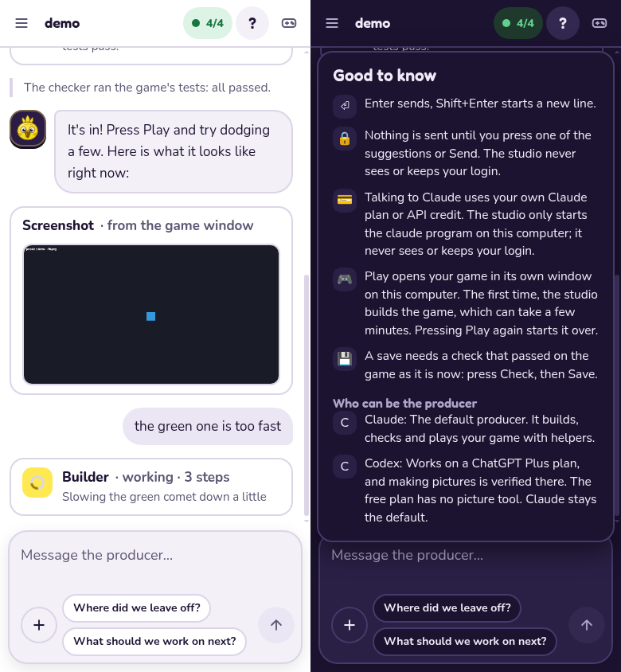

**Help (?)** holds the fine print: Enter sends and Shift+Enter starts a new line; nothing is
sent until you press a suggestion or Send, and Studio never sees your login; who pays (your own
Claude plan or API credit, or your ChatGPT plan for Codex); what Play does; that a save needs a
passing check; and, with more than one producer, one line on each (Claude is the default; only
Codex, on a ChatGPT Plus plan or better, can make pictures).

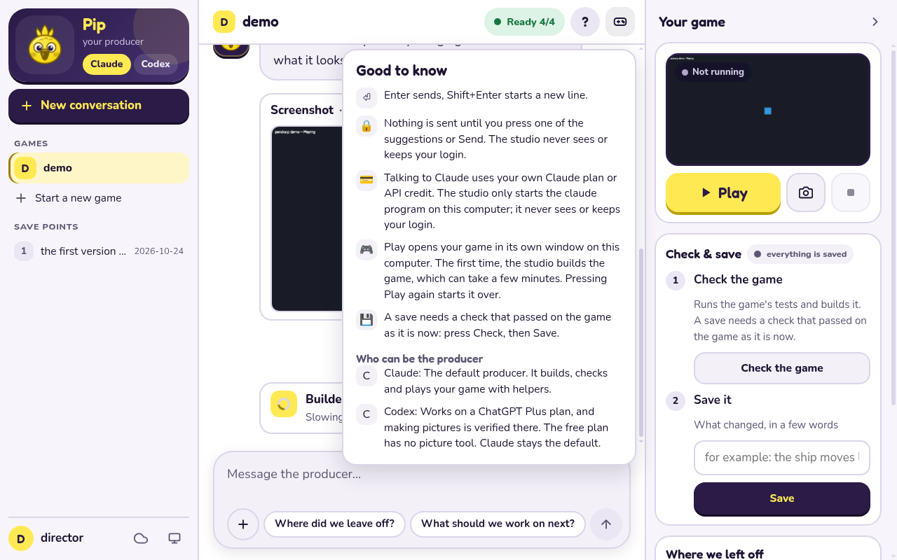

## Startup checks

The first thing the page does, before any chat, is look at your setup. The answer is the pill in
the top bar: green **Ready 4/4** when everything is fine, red **Setup needed** (or amber when
something could not be checked) when it is not. Click the pill to see every check with a tick, or,
for one that is not ready, one plain line on how to fix it. When something is not ready the checks
open by themselves the first time. Fix it, then press **Check again**.

It is only information: it never blocks Play, Check, Save or the chat, and it makes no model call,
so it costs nothing.

| Check | What it means | If it is not ready |
| --- | --- | --- |
| Installed | the `claude` (or `codex`) program is on this computer | install it from the setup page the check names |
| Signed in | you are signed in to that program | open a terminal, run `claude`, and follow its sign-in |
| Folder trusted | Claude knows it may use this folder | open a terminal in this folder, run `claude`, and choose **Yes, I trust this folder** |
| Edits in `games/` allowed | the producer may change files in your game folder | put the file back: `git checkout -- .claude/settings.json` |

A check Studio cannot answer safely says **Could not check** with a hint, instead of a guess.
Codex gets the first three checks and no edit check.

Under **Optional** the checks also list **Lavish (visual boards)**, a program Studio works fine
without (see [Visual boards](#visual-boards)). It is never counted in **Ready** and never a
failure: when it is missing, the row says what it is and shows the one command that adds it,
`tmp/para board install`, with a **Copy** button. The page installs nothing itself.

**The first-run card.** When Claude is installed but not signed in, or does not trust this folder,
the checks also show a card for the first run, which happens in a terminal the page cannot answer
for you. It shows the folder to open a terminal in and the command to paste, with a **Copy**
button, and says in plain words what Claude asks the first time:

- how text should look (any choice is fine);
- how to sign in: an Anthropic Console API key (pay as you go, the way Claude Code documents), or
  a Claude Pro or Max subscription (your own choice; the chats count toward its usage limits), or
  a company account;
- "Do you trust the files in this folder?": choose **Yes, I trust this folder**. The highlighted
  choice is **No, exit**, so move down first; pressing Enter without moving leaves the folder
  untrusted.

On macOS the card also has **Open a terminal here**. Linux has no one standard terminal and
Windows has several, so there the card only offers the command to copy. The card only shows text
and copies it: Studio never reads, keeps or touches a login, and never types into the terminal.

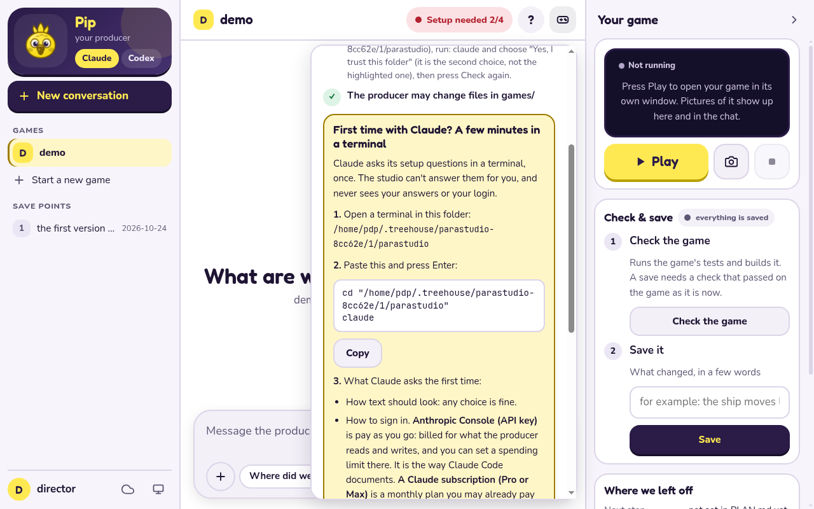

**A message sent while the setup is broken is kept.** If a turn ends in an error before the
producer said anything (not signed in, out of credit, not installed), your message goes back into
the message box (in front of anything typed since, with a blank line between) and the page says to
fix the problem and press Send again. The startup checks are asked again at the same time.

## If something goes wrong

- **The page says it lost touch with Studio.** The terminal window running `tmp/para studio` was
  closed or stopped. Run it again and use the new link (the key in the link changes every run).
  Closing the browser tab does not stop Studio.
- **"codex" is not installed, or not signed in.** Same as the next item for Codex: install it from
  https://developers.openai.com/codex/cli, run `codex` once in a terminal and sign in, then press
  "Check again". A turn that ends with "no usage left" is Codex's plan talking; wait for it to
  reset (the message says when, if Codex told us) or pick Claude.
- **"claude" is not installed, or not signed in.** The startup checks pill turns red and the
  checks open with the fix (and, for signing in, the first-run card), and so does the chat if you
  send a message anyway; your message stays in the box to send again. Install Claude Code from
  Anthropic's setup page (https://code.claude.com/docs/en/setup), open a terminal, run `claude`
  once and sign in, then press "Check again" on the page. Studio never asks for a login or key
  itself.
- **The producer says it is not allowed to run commands or change files in your game folder.**
  Claude Code ignores the folder's allow-list until you have said Yes to its trust question there
  (the startup check says "Claude does not trust this folder yet", and so does the chat): open a
  terminal in the folder, run `claude`, choose **Yes, I trust this folder** (the highlighted
  choice is "No, exit", so move down first), then press "Check again" on the page. If the refusal
  names a file outside `games/`, that is on purpose (see "What the producer can and cannot
  change").
- **Play says the game did not build.** Ask the producer to fix it; "Show the details" has the
  lines the compiler printed. If it says Nim or a C compiler was not found, `nim --version` and
  `gcc --version` need to work in the terminal you started Studio from (see
  [windows-first-game.md](windows-first-game.md) for what to install).
- **Play says there is no screen.** On Linux a window needs `DISPLAY` or `WAYLAND_DISPLAY`; over a
  remote connection (SSH) there is none. Run Studio on the computer in front of you.
- **Play says the graphics driver cannot start OpenGL**, or the game stops straight away and says
  nothing. Update the graphics driver. A virtual machine often has no real graphics at all; that
  is not a bug in your game (see the top of [windows-first-game.md](windows-first-game.md)).
- **The port is busy** ("could not start listening"). Run `tmp/para studio --port N` with another
  number, or leave `--port` out and Studio picks a free one.
- **A firewall or antivirus asks about Studio.** It only listens on your own computer,
  so no prompt should appear; if one does, "Cancel" and "Allow" both work, and
  please tell us it happened.
- **Where are the logs?** Studio writes none. The page's "Show the details" boxes hold the last
  lines of a failed build or a window that stopped; the terminal where you started it only shows
  the link. The pictures are in `tmp/studio/shots/`.
- **How do I stop it?** Press Ctrl+C in the terminal where you started it. That closes the game
  window Studio opened and ends a chat turn that is still running.

## Start a game

With no game in `games/` the greeting says so and offers **Start a game**; **Start a new game** in
the sidebar does the same at any time. Type a name (spaces and dashes become `_`, capitals become
small letters, so "Space Frogs" is `space_frogs`) and Studio makes the game and opens it. A
problem with the name is said in plain words: it has to be small letters, digits and `_`, start
with a letter, be at most 40 characters, and not be taken. You get the same thing as `para new` in
a terminal: a copy of `template/` in `games/<name>/`, a git repository of its own. Starting a game
is refused while a Check, Save or chat turn is running.

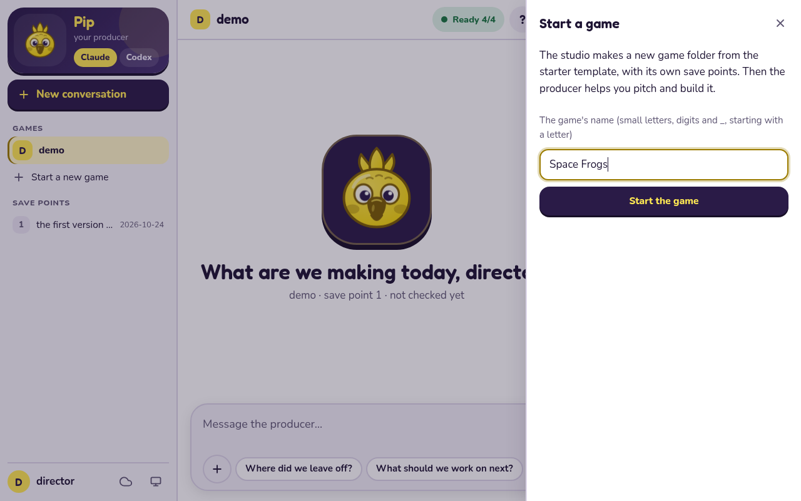

## Talking to the producer

The chat is the same producer you get in a terminal, in a page. It runs the `claude` program
**you** installed and signed in to (or `codex`), one turn at a time, in your paraloop folder.

- **Accounts.** Studio never reads, asks for, stores, logs, forwards or shows a login, a token or
  an API key, and has no sign-in screen. It only starts the unmodified program you installed and
  signed in to yourself. Install Claude Code from Anthropic's setup page
  (https://code.claude.com/docs/en/setup; on Windows that is your step, Studio installs nothing),
  then open a terminal once, run `claude` and sign in. An API key, set the way Claude Code's own
  setup describes, is the documented path; a Pro or Max login is your own choice. Using Claude
  costs your own plan or API credit. Nothing is sent until you press one of the suggestions
  ("Where did we leave off?" or "What should we work on next?") or send a message.
- **Claude or Codex.** Pip's card lists the producers this computer can use and lets you pick one
  per game. Claude is the default until you pick Codex for a game. A pick takes effect from the
  next message and is refused while a turn is running. Each has its own chats, so
  switching back resumes where that one stopped; the one you switch to has not seen the other's
  chat and picks the game up from its notes (`PLAN.md`, `NOTES.md`) like any fresh producer. For
  Codex, install Codex CLI from OpenAI's page (https://developers.openai.com/codex/cli; on
  Windows that is your step), open a terminal once, run `codex` and sign in. Using Codex costs
  your own ChatGPT plan or OpenAI API credit.
- **One turn at a time.** Check, Save and Backup wait while the producer is working, and the
  other way round. **Stop** ends the turn and everything it started. A turn is stopped after
  `--turn-timeout` minutes (default 60; long builds are normal).
- **Chats.** Each game keeps every chat you had with its producer, and a restart or a reopened
  page picks up the one you were in. **New chat** starts a fresh one; see "Your chats" below.
- **Helpers** (builder, checker, scout) show as cards in the chat.

### Your chats

The **Chats** list under **New chat** on the left has your earlier chats with this game's
producer, the one you used last at the top. Each shows the start of the first message you sent in
it and when you last used it (for example "5 min ago", "yesterday" or "12 Oct").

- **Pick one** to go back to it. Its messages show again as they were: what you wrote, what the
  producer said, its "Reading ..." and "Running ..." lines, helper cards and notes. The producer
  carries on that same conversation, so just keep talking. This works after you close and start
  Studio again too: the chat you were in opens with its messages.
- **Chats from before Studio kept messages** (ones that showed only a title) get their messages
  back the first time you open them, from Claude's own record of the conversation on this
  computer. Studio only reads that record, for that one conversation, and then keeps the messages
  in its own file, so this happens once. Thinking, tool results and what helpers said among
  themselves are not shown, the same as in a live chat. When there is no record (it was removed,
  or the chat was with **Codex**, whose records Studio does not look up), the chat opens with a
  plain note that its earlier messages are not kept, and the conversation still continues from
  where it left off.
- **New chat** starts a fresh one. Your earlier chats stay in the list. Until you send its first
  message, the new chat is the "New chat" line at the top of the list.
- **Delete** (the bin next to a chat) asks first. Saying yes takes the chat off the list for good
  and removes its messages from this computer, and you cannot pick it up again. Your game, its
  files and its save points stay exactly as they are.
- While the producer is working the list is greyed out: wait for the answer, or press **Stop**,
  then pick or delete a chat.
- Each producer keeps its own chats: with **Codex** picked, the list shows your chats with Codex.
- Chats stay on this computer, in the `tmp/studio/` folder: they are never uploaded, never part
  of a save point or a backup, and a chat's Delete removes them. For each chat Studio keeps its
  title (the start of your first message, at most 60 letters), when it started and was last used,
  the producer's own number for the conversation, and its messages as the chat showed them.
  Anything that looks like a key or a password is taken out before it is written down.
- A very long message is kept up to about 16,000 letters, with a note where it was cut. Each chat
  keeps about its last 500 KB of messages; past that its oldest messages are left out and the chat
  starts with a note saying so. Your conversation with the producer is not affected: it carries on
  from where it left off either way.

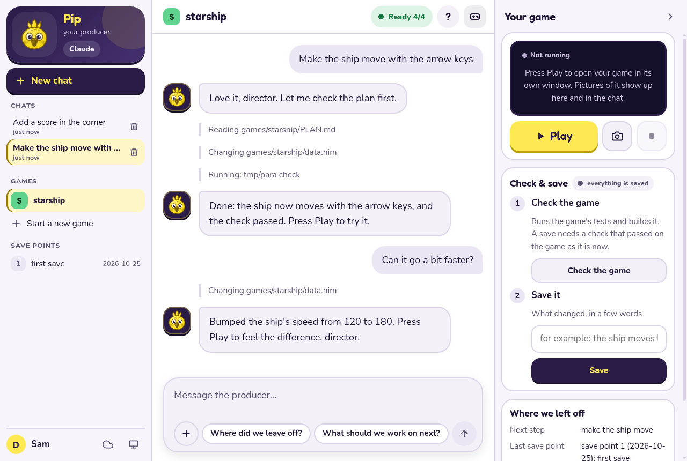

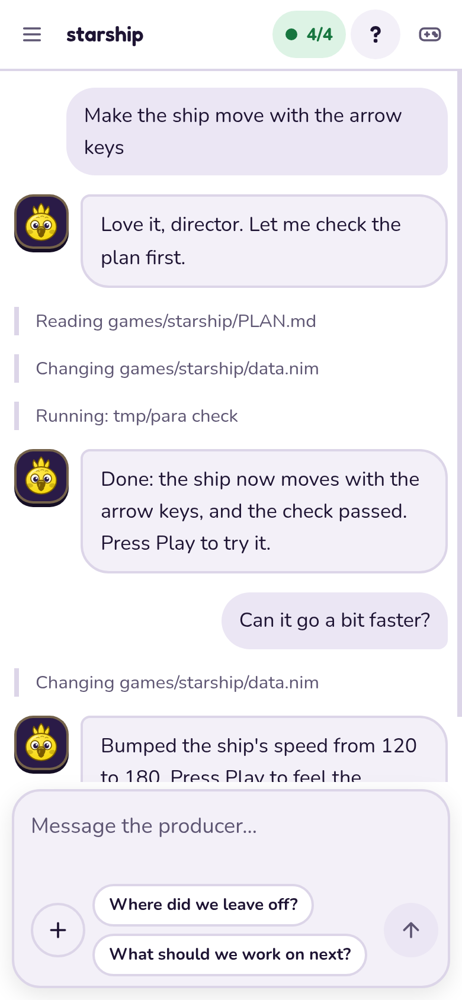

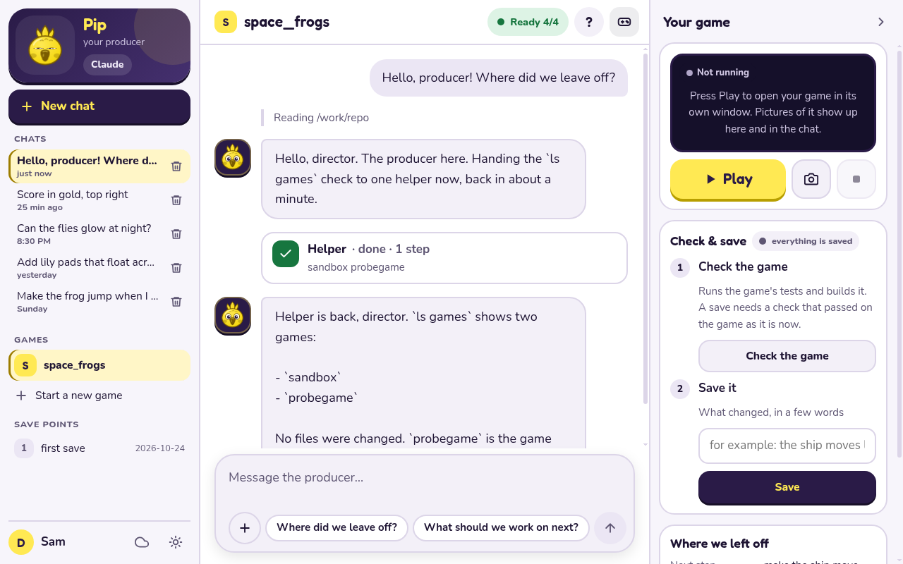

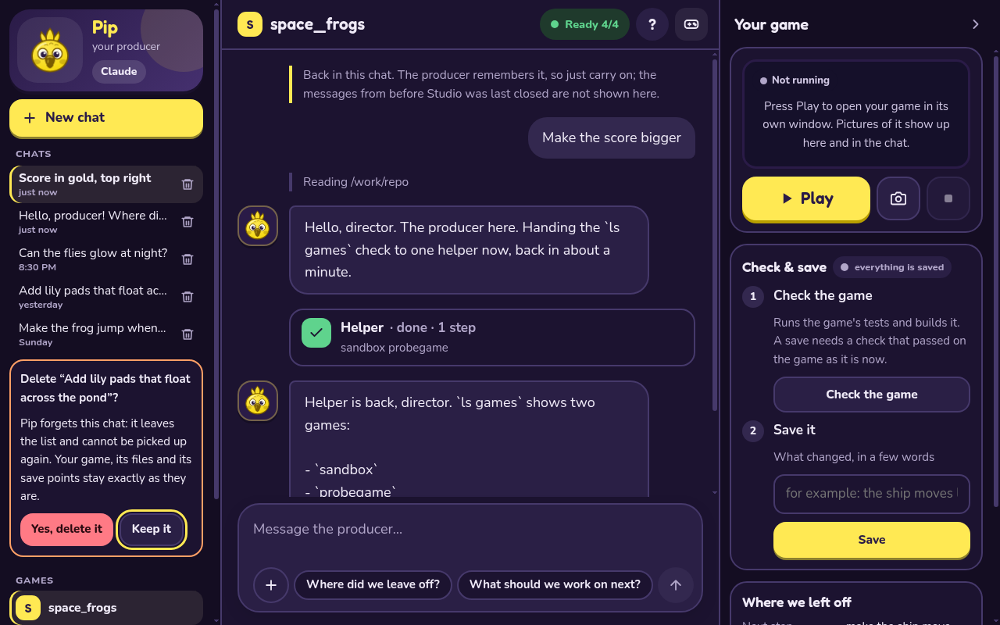

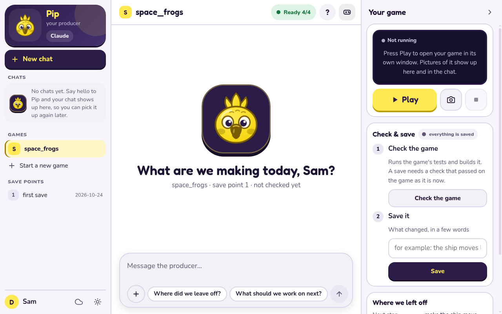

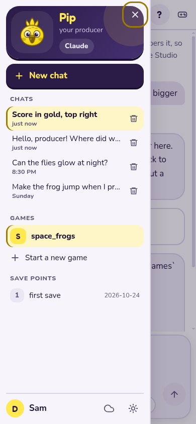

### Helpers work in their own copy

When the producer hands a step to the builder (or a picture to the art helper), that helper gets
its own copy of your game and works only there. Your game stays exactly as it was, so **Play**
always plays the last finished version while a helper is busy, and two helpers can work at the
same time without getting in each other's way: say, the builder on a new rule while the art
helper draws the ship. You never make or tidy these copies yourself; Studio and the producer do.

Under Pip's card a short line says what each helper is doing: "Builder is working on your
change", "Checking it", "Art helper is drawing". When a helper is done and its work passed the
checks, the producer puts it into your game, and then Check and Save work as always.

If Studio or the chat was closed while a helper was working (a crash, a closed window), nothing is
lost: the helper's work waits in its copy. Next time, the line under Pip's card says "Builder's
work from last time is waiting" with two buttons. **Land it** puts that work into your game as
unsaved changes (then press Check, then Save); **Keep it** leaves it for the producer, who will
mention it when you next talk. If the helper and your game both changed the same thing, or you
have unsaved changes to a file the helper also changed, Land it says so in plain words and changes
nothing in your game.

### What the producer can and cannot change

The producer and its helpers can change files in your game folder (`games/`) and nothing else. The
producer writes `PITCH.md`, `PLAN.md`, `CHOICES.md`, `DESIGN.md`, `PLAYTEST.md` and `NOTES.md`
there, and the builder, checker and scouts change the game's code and reports there. Everything
outside `games/` stays read-only in Studio: the playbooks (`.agents`), `.claude/settings.json`,
`AGENTS.md`, `tools`, `src`, `docs`, `tests`, `template`, `skills` and the files at the top of the
repository. A game's own `.git` folder is refused too; saving goes through Save (`para save`). If
something wants to change a file outside `games/`, the chat shows, for example:

> The producer wasn't allowed to change `AGENTS.md`: in the studio it can only change
> files inside your game folder (`games/`). To change the studio itself, use the terminal.

and the producer is told not to work around it. A command that is not on the producer's list is
refused too, and the chat says so in plain words ("A helper wasn't allowed to run ... Ask the
producer to do it a different way.") instead of hanging. These permissions only take effect in a
folder Claude Code trusts (see the first-run card and "If something goes wrong" above).

## Play and screenshots

**Play** builds the game (the first time takes a few minutes, later ones are quick) and opens its
own window on this computer. The page says how the build is going, and if the window cannot open
it says why in plain words and what to do (the game did not build, this computer has no screen for
it, the graphics driver cannot do OpenGL). **Stop game** closes the window. Pressing **Play** again
closes the old window and starts over, so there is one game window at a time, and closing Studio
(Ctrl+C) closes it too. **Show me a screenshot** asks the open window for a picture and puts it in
the chat as a card; Studio keeps the newest 20 in `tmp/studio/shots/` and deletes older ones. If
the window Studio opened belongs to a different game than the one picked on the page, the
screenshot is refused and the page says which game is open. Play is refused while a Check, Save or
Backup runs. The producer can ask you to press either.

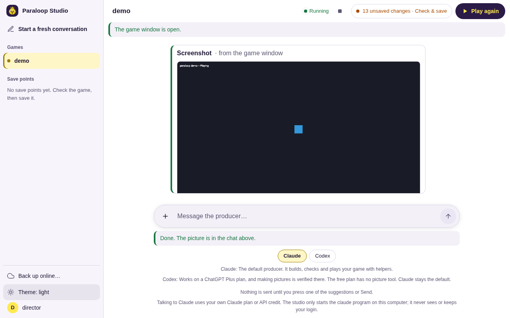

## Visual boards

When a choice is easier to see than to read (art options, picking a look, screenshots to compare,
a plan with options), the producer can put it on a **board**: a page in your browser where you
click your picks, leave a note if you like, and press one button, and it comes back to the
producer. The answer is written down in your game's `CHOICES.md` like any other choice.

- **With Lavish** (optional) the board is live: the button sends your picks straight back to the
  producer. Lavish is `lavish-axi`, a free program (MIT licence) by Kun
  Chen from the npm registry (<https://www.npmjs.com/package/lavish-axi>); it needs no account but
  needs Node.js 22 or newer, which Studio itself does not. It is never installed for you. To add
  it, run this in a terminal in the Studio folder:

  ```text
  tmp/para board install
  ```

  It says what it installs (`lavish-axi` 0.1.92, the version Studio was checked with), from where,
  into which folder and how big, then asks a plain yes or no; only `y` or `yes` installs. It never
  uses admin rights: if npm would need them, it stops and says so.
- **Without Lavish** the board is the same page, opened on its own; its button copies your picks
  as one line for you to paste into the chat. In Studio the screenshots in the chat (**Show me a
  screenshot**) work too.

**It stays on your computer.** Studio runs Lavish on `127.0.0.1` only, on its own port (4388) with
its own settings in `tmp/lavish/`. Left to itself Lavish would also listen on your Tailscale
address when Tailscale is running (so a phone on your tailnet could open a board); Studio turns
that off, and closes a board at once if Lavish ever gives a link that is not on this computer.
Studio also switches off Lavish's anonymous usage counts and its **Publish** menu item, which
would otherwise put a copy of the board on a public website (ht-ml.app): with Studio it fails and
nothing leaves the computer. Lavish stops by itself once no board is open, or after 30 idle
minutes.

Boards are scratch pages in `games/<game>/review/`, made from one shared template so every board
looks the same: the Studio's colours, fonts and Pip, in light and dark, or your game's own palette
when its `art/style.toml` names one. New games leave `review/` out of their save points.

## Check, Save and Backup

They do what the same commands do in a terminal (`para check`, `para save -m`,
`para backup --push --yes`), so their guards still hold: a save needs a fresh passing check, and a
backup only goes to the remote named `backup`, never to `origin`, and only after you click yes.
Save and Backup work in the game's own git repository (`games/<game>/.git`, which `para new`
makes); a game without one is saved in the repository that contains `games/`, as before.

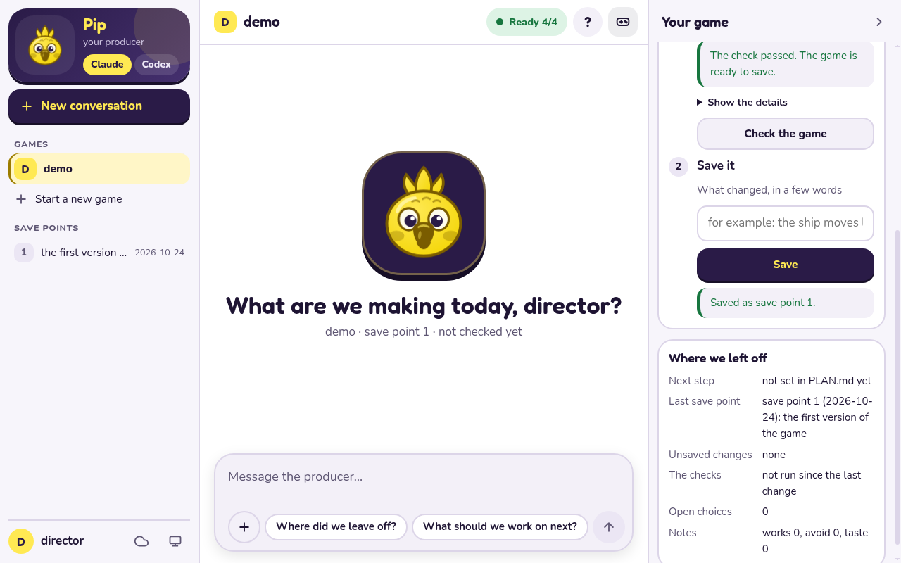

## Two copies, two studios

One studio runs one chat turn at a time (Check, Save and Backup wait for it), because the producer
changes files in the folder. Inside that one turn the producer's helpers already work at the same
time, each in its own copy (see "Helpers work in their own copy"). To hold two conversations at
once, keep two copies of the folder and run a studio in each. They share nothing: each has its own
files, `tmp/` and save points, so they cannot step on each other.

```
git clone <the folder you have now> ../parastudio-b      # a second copy (or clone the repository again)
cd ../parastudio-b
nimble install -d -y && nimble setup
nim c --hints:off --outdir:tmp tools/para/para.nim
tmp/para studio --port 8788 --game <the other game>    # the first studio keeps its own port and link
```

Put the two browser tabs side by side. Each studio prints its own link (the key in it differs), and
each copy can use a different producer: pick Codex on the page in one, leave the default in the
other. Run `claude` and `codex` once in the new folder to answer their trust question. A save
lands in the copy it was made in; the simplest way to keep things straight is one game per copy.
Bringing the two lines of work together later is the git merge a terminal user would do (`git fetch
../parastudio-b` then `git merge`), not a step the page has.

---

Changing Studio itself (how it binds, the checks, the chat's commands, the source files, tests and
fonts)? See [studio-maintainers.md](studio-maintainers.md).
